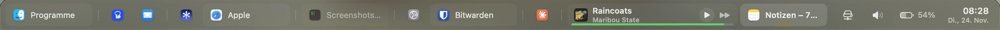
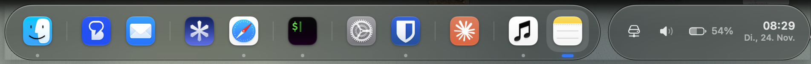
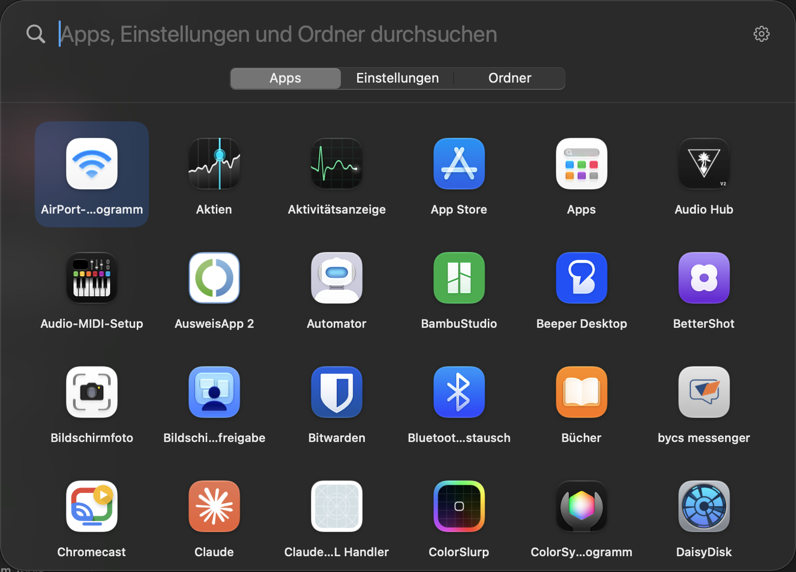

<div align="center">


# Pier

**Dein Dock, nur besser.**<br>
Ein freier Dock-Ersatz für macOS, gebaut mit Swift und SwiftUI.


[**Installieren**](#installieren) · [Funktionen](#funktionen) · [Tastenkürzel](#tastenkuerzel) · [Datenschutz](#datenschutz) · [FAQ](#faq)

<br>



<sub>Als Leiste: Apps nach Gruppen sortiert, der Musik-Tab zeigt Titel, Steuerung und Fortschritt.</sub>

</div>

<br>

> [!NOTE]
> **English:** Pier is a free, open-source Dock replacement for macOS 15+, written in Swift/SwiftUI. It offers a floating pill or a taskbar-style bar on any screen edge, window previews, badges and progress, smart grouping of apps by category, an ⌥Tab window switcher, a launcher and widgets (music, clock, battery, sound, devices). The macOS Dock keeps running hidden, so Mission Control, Spaces and ⌘Tab work as usual. The app and this page are in German; install it with Homebrew or build it with `./build.sh --install` (see below).

Pier blendet das Mac-Dock aus und stellt es beim Beenden wieder her. Der Dock-Prozess selbst läuft weiter, deshalb funktionieren **Mission Control, Spaces und ⌘-Tab wie gewohnt**.

## ✨ Auf einen Blick

<table>
<tr>
<td width="33%" valign="top">

### 🪟 Zwei Stile
Schwebende **Pille** oder durchgehende **Leiste**, an jeder Bildschirmkante, mit 1 bis 5 Zeilen.

</td>
<td width="33%" valign="top">

### 🧠 Ordnet sich selbst
„Intelligent anordnen“ sortiert Apps nach Kategorie und Nutzung, mit Vorschau, bevor etwas passiert.

</td>
<td width="33%" valign="top">

### 🎵 Lebt mit
Badges, Download-Fortschritt, Musik mit Cover-Farbe und Kacheln, die blinken, sobald etwas Neues ankommt.

</td>
</tr>
<tr>
<td valign="top">

### 🔍 Launcher
Sofortsuche über Apps, Systemeinstellungen und Ordner, per <kbd>⌥</kbd> <kbd>Leertaste</kbd>.

</td>
<td valign="top">

### 🔀 ⌥Tab für Fenster
Ein Umschalter für Fenster statt Apps, dazu Vorschau beim Überfahren.

</td>
<td valign="top">

### 🔒 Bleibt lokal
Keine Konten, kein Tracking, keine Daten ins Internet.

</td>
</tr>
</table>

<div align="center">



<sub>Als Pille: App-Kacheln mit Trennlinien zwischen den Gruppen, rechts die Widgets.</sub>

<br><br>



<sub>Der Launcher: tippen, Enter, fertig.</sub>

</div>

<a id="funktionen"></a>

## 🧩 Funktionen

<sub>Zum Aufklappen auf eine Zeile klicken.</sub>

<details>
<summary><b>🚢 Dock</b>: Stile, Position, Themen, Badges, Anpinnen</summary>
<br>

- Zwei Stile: schwebende Pille (Launcher · Apps · Widgets) oder durchgehende Leiste
- Position unten, links, rechts oder oben – für Pille und Leiste; die Pille sitzt in der Mitte, am Anfang oder am Ende ihrer Kante oder schwebt frei (am Griff ziehen, die Stelle bleibt gespeichert)
- Bildschirm wählbar: Hauptbildschirm, ein bestimmter Bildschirm oder alle
- Automatisches Ausblenden
- Beschriftung der Leiste: automatisch (Name nur bei genug Platz), nur Icons oder immer Icon und Text
- Leiste oben oder unten mit 1 bis 5 Zeilen: am Innenrand ziehen oder in den Einstellungen wählen
- Leiste links oder rechts als Spalte: mit Titeln 210 pt breit, bei „Nur Icons“ schmal; passen nicht alle Tabs hinein, werden sie flacher
- Anpinnen und Lösen über das Kontextmenü, Drag & Drop (Datei auf App öffnet sie, `.app` pinnt an, Ordner wird zum Stapel, andere Dateien auf freier Fläche werden angepinnt)
- Finder-Stapel mit den neuesten Dateien eines Ordners
- Apps lassen sich von der Anzeige ausschließen, „Sofort beenden…“ fragt vorher nach

</details>

<details>
<summary><b>🎨 Farbthemen</b>: elf Looks, einer färbt sich nach dem Album-Cover</summary>
<br>

System, Graphit, Mitternacht, Ozean, Lavendel, Koralle, Salbei, Abendrot, Transparent, eigene Farbe und **„Now Playing“**, das sich nach dem Cover des laufenden Titels in Music oder Spotify färbt.

Das Thema bestimmt die Akzentfarbe für die aktive App, Fortschritt und Auswahl sowie eine leichte Tönung des Glases von Dock, Popups, Launcher und ⌥Tab. „Transparent“ lässt das Glas im Dock ganz weg.

</details>

<details>
<summary><b>🔔 App-Status</b>: Badges, Fortschritt, „Reagiert nicht“</summary>
<br>

- Badges: in breiten Leisten-Tabs groß und rot rechts im Tab, sonst klein am Icon, dazu im Tooltip (die Werte kommen aus dem versteckten Mac-Dock)
- Aufmerksamkeit: Erscheint oder steigt ein Badge, blinkt die ganze Kachel
- App-Fortschritt: Downloads und Kopiervorgänge füllen den Tab und zeigen „14 %“; die Titelposition von Music, Spotify und VLC erscheint als grüner Balken (Music und VLC fragen beim ersten Mal nach der Erlaubnis, sie zu steuern)
- Startende Apps mit wandernden Streifen, Apps, die nicht reagieren, mit roten Streifen und „Reagiert nicht“; ausgeblendete Apps und minimierte Fenster abgeblendet
- <kbd>⌃</kbd> halten zeigt CPU- und Speicherverbrauch der laufenden Apps

</details>

<details>
<summary><b>🧠 Ordnung</b>: Gruppen, Reihenfolge, „Intelligent anordnen“</summary>
<br>

- „Intelligent anordnen“: gruppiert Apps nach Kategorie und Nutzung, mit Trennlinien und verschiebbaren Gruppen; zeigt für alle installierten Apps, in welche Gruppe sie beim Öffnen kommen
- Reihenfolge der laufenden, nicht angepinnten Apps: nach Start, alphabetisch oder in ihre Gruppe einsortiert – z. B. landet ein geöffnetes Xcode hinter den angepinnten Entwickler-Apps (angepinnte bleiben in deiner Reihenfolge)

</details>

<details>
<summary><b>🪟 Fenster</b>: Vorschau, Gruppieren, Umschalter, Titelleisten-Gesten</summary>
<br>

- Fenster-Vorschau beim Überfahren, Fenster lassen sich aus der Vorschau ziehen
- Fenster gruppieren (Leiste): nie, immer oder automatisch, sobald die Tabs zu schmal werden; ein gemeinsamer Tab zeigt die Zahl der Fenster
- Scrollen über einem Icon wechselt zwischen den Fenstern der App
- Filter auf den aktuellen Space
- ⌥Tab-Umschalter für Fenster (siehe [Tastenkürzel](#tastenkuerzel))
- Scrollen auf der Titelleiste (muss eingeschaltet werden): hoch = maximieren, runter = zentrieren, links/rechts = Bildschirmhälfte
- Fenster, die unter das Dock reichen würden, werden bis an dessen Rand gekürzt bzw. verschoben (Leiste an jeder Kante, Pille unten)

</details>

<details>
<summary><b>🔍 Launcher und Widgets</b>: Suche, Musik, Uhr, Akku, Ton, Geräte</summary>
<br>

- Launchpad-Ersatz mit Sofortsuche über Apps, Bereiche der Systemeinstellungen und Ordner (Benutzerordner plus eigene), öffnet über die Dock-Kachel oder <kbd>⌥</kbd> <kbd>Leertaste</kbd>
- 🎵 Musik-Widget für Music und Spotify mit Steuerung über die Medientasten; in der Leiste wird stattdessen der Tab des Players breiter und zeigt Titel, Interpret, Abspielen/Pause und Weiter
- 🕐 Uhr: darüberfahren zeigt Kalender (Woche ab Montag) und Zifferblatt
- 🔋 Akku: darüberfahren zeigt Restlaufzeit, maximale Kapazität, Zustand und Ladezyklen
- 🔊 Ton: Ausgang und Eingang per Klick wechseln
- 💾 Geräte: externe Laufwerke einzeln oder alle auswerfen, auf Wunsch gekoppelte Bluetooth-Geräte verbinden oder trennen

</details>

<a id="tastenkuerzel"></a>

## ⌨️ Tastenkürzel

| Kürzel | Wirkung |
|---|---|
| <kbd>⌥</kbd> <kbd>Leertaste</kbd> | Launcher öffnen |
| <kbd>⌥</kbd> halten + <kbd>Tab</kbd> | Fenster wählen, <kbd>⇧</kbd> <kbd>Tab</kbd> rückwärts, ⌥ loslassen wechselt |
| <kbd>⌥</kbd> <kbd>Esc</kbd> | Umschalter abbrechen |
| <kbd>⌃</kbd> <kbd>⌥</kbd> <kbd>1</kbd> … <kbd>9</kbd> | n-te angepinnte App öffnen |
| <kbd>⌃</kbd> halten | CPU- und Speicherverbrauch anzeigen |

<sub>Jedes Kürzel lässt sich in den Einstellungen einzeln ein- und ausschalten.</sub>

<a id="installieren"></a>

## 📦 Installieren

**Voraussetzungen:** macOS 15 oder neuer, Swift 6 (Xcode 16 oder Command Line Tools).

Es gibt keine fertige App zum Download, Pier wird aus dem Quellcode gebaut.

<details open>
<summary><b>🍺 Mit Homebrew</b> (empfohlen)</summary>
<br>

```sh
brew install w1nd-surf3r19/pier/pier
ln -sf "$(brew --prefix)/opt/pier/Pier.app" ~/Applications/Pier.app
open ~/Applications/Pier.app
```

</details>

<details>
<summary><b>🛠️ Von Hand bauen</b></summary>
<br>

```sh
git clone https://github.com/W1nd-Surf3r19/Pier.git
cd Pier
./build.sh            # baut build/Pier.app
./build.sh --install  # baut, beendet ein laufendes Pier und installiert nach ~/Applications
open ~/Applications/Pier.app
```

Tests laufen mit `swift test`.

</details>

<details>
<summary><b>🔏 Eigene Signatur</b>: damit macOS nicht nach jedem Neubau neu fragt</summary>
<br>

Ohne eigene Signatur signiert `build.sh` ad hoc. Das funktioniert, aber macOS fragt nach jedem Neubau erneut nach Bedienungshilfen und Bildschirmaufnahme. Mit einem Zertifikat aus der Schlüsselbundverwaltung (z. B. ein kostenloses „Apple Development“-Zertifikat aus Xcode) bleiben die Berechtigungen erhalten. Den Hash zeigt `security find-identity -p codesigning`:

```sh
PIER_SIGN_IDENTITY=<SHA-1-Hash> ./build.sh --install
# oder dauerhaft, die Datei ist von Git ausgenommen:
echo <SHA-1-Hash> > .sign-identity
```

</details>

> [!IMPORTANT]
> Beim ersten Start braucht Pier unter *Systemeinstellungen › Datenschutz & Sicherheit* zwei Berechtigungen:
> - **Bedienungshilfen** für Fenster, Badges und Tastenkürzel
> - **Bildschirmaufnahme** für die Fenster-Vorschau
>
> **Bluetooth** nur, wenn die Bluetooth-Liste eingeschaltet ist; macOS fragt beim ersten Öffnen.

<a id="datenschutz"></a>

## 🔒 Datenschutz

- Pier sendet keine Daten ins Internet. Die einzige Netzabfrage lädt das Spotify-Cover von der Adresse, die Spotify selbst liefert.
- Nutzungsdaten für „Intelligent anordnen“ (wie lange welche App vorn war) bleiben lokal in `~/Library/Application Support/Pier/usage.json`.
- Pier ändert die Mac-Dock-Einstellungen `autohide` und `autohide-delay`, um das Mac-Dock auszublenden, und stellt sie beim Beenden wieder her.
- Details und Meldung von Sicherheitslücken: [SECURITY.md](SECURITY.md)

<a id="faq"></a>

## 💬 Fragen und Antworten

<details>
<summary><b>Wo liegen meine Einstellungen?</b></summary>
<br>

Angepinnte Apps, Ordner und Einstellungen liegen in `~/Library/Application Support/Pier/config.json`. Ändern lässt sich alles über das Einstellungsfenster.

</details>

<details>
<summary><b>Wie werde ich Pier wieder los?</b></summary>
<br>

Pier über sein Menü beenden („Pier beenden“), dabei kommt das Mac-Dock zurück. Danach `~/Applications/Pier.app` und `~/Library/Application Support/Pier` löschen.

</details>

<details>
<summary><b>Die Berechtigungen sind an, aber Pier erkennt sie nicht</b></summary>
<br>

Das passiert nach einem Update oder Neubau: Die Homebrew-Version ist ad hoc signiert, und macOS hält jede neu gebaute App für eine andere. Der Schalter in den Systemeinstellungen gehört dann noch zur alten Version. Pier beenden, die Einträge zurücksetzen und neu erlauben:

```sh
for s in Accessibility ScreenCapture AppleEvents BluetoothAlways; do tccutil reset $s app.pier.dock; done
open ~/Applications/Pier.app
```

Dauerhaft vermeiden lässt sich das nur mit einer [eigenen Signatur](#installieren) beim Selbstbauen.

</details>

<details>
<summary><b>Mein Mac-Dock ist verschwunden!</b></summary>
<br>

Ist Pier abgestürzt oder wurde gelöscht, ohne es zu beenden, bleibt das Mac-Dock unsichtbar. So holst du es zurück:

```sh
defaults delete com.apple.dock autohide-delay; defaults write com.apple.dock autohide -bool false; killall Dock
```

</details>

<details>
<summary><b>Was kann Pier (noch) nicht?</b></summary>
<br>

- Fenster in einen anderen Space zu verschieben oder die Nummer eines Space anzuzeigen geht nur über private APIs und ist deshalb nicht eingebaut.
- Jedes Dock zeigt alle Fenster an, nicht nur die auf seinem Bildschirm.
- Mit mehreren Bildschirmen ist Pier bisher nicht getestet.

</details>

---

<div align="center">

[MIT](LICENSE) © 2026 Malte Rill · Das App-Icon wurde mit Google Gemini erstellt.

<sub>Gefällt dir Pier? Ein ⭐ freut mich.</sub>

</div>
